# Guia do Diego — tudo sobre o SCL 2.0 num lugar só

> Documento escrito para você, sem precisar ler código. É atualizado a cada PR.
> **Última atualização:** 24/09/2026, portal do proprietário com filtros e números (M5.1).

---

## 1. Resumo em 30 segundos

- **O que é:** o novo sistema de gestão da Sua Casa Leblon (painel interno, financeiro,
  portal do proprietário, portal do hóspede, site com reserva direta e integrações com
  Beds24, Mercado Pago e WhatsApp).
- **Onde está:** tudo neste repositório do GitHub, `al-life/scl-reconstrucao`.
- **Quem constrói:** o Claude, por meio de uma rotina automática a cada 3 horas e das
  conversas com você.
- **Quem decide:** você. Por enquanto o Claude faz os merges sozinho (com CI verde e revisão
  automática sem pendências), por sua autorização; você pode revogar quando quiser.
- **Está em uso?** **Não.** Só vai ser usado "para valer" quando tudo estiver pronto
  (marco M11).

---

## 2. Onde estamos

| Etapa | O que entrega | Situação |
|---|---|---|
| M0 Fundação | Base do app, banco de dados, layout, publicação na Vercel | 🟡 só falta a Vercel |
| M1 Acesso | Login (Google/código por e-mail), convites, permissões | ✅ pronto |
| M2 Cadastros | Imóveis, proprietários, contratos e comissões | ✅ pronto |
| M3 Reservas | Reservas, calendário central, leitura do Beds24 | 🟡 em andamento |
| M4 Financeiro | Lançamentos, comissões, despesas, dashboard, aba Apartamentos | 🟡 em andamento |
| M5 Portal do proprietário | Relatórios, saldos, PDF | 🟡 em andamento |
| M6 Operação | Limpezas, manutenção, agenda diária | ⚪ aguardando |
| M7 Site público | Site novo com disponibilidade real | ⚪ aguardando |
| M8 Reserva direta | Pagamento pelo Mercado Pago | ⚪ aguardando |
| M9 Portal do hóspede | Acesso do hóspede e mensagens automáticas | ⚪ aguardando |
| M10 WhatsApp | Caixa de entrada do WhatsApp no painel | ⚪ aguardando |
| M11 Produção | Dados reais, domínio, entrada em uso | ⚪ aguardando |

**Itens já prontos (na `main`):**
- M0.1: repositório limpo, plano único (ROADMAP) e regras para o Claude.
- M0.2: esqueleto do aplicativo, com testes automáticos.
- M0.3: conexão com o banco de dados (Neon) e banco de teste automático.
- M0.4: **painel interno com menu e filtro global** (imóveis + mês/ano). Todas as seções
  aparecem no menu, marcadas como "em construção" até ganharem conteúdo. Funciona no
  celular: o menu vira uma faixa que desliza para o lado.
- M1.1: **quem pode ver e fazer o quê.** Existem quatro papéis:
  - **admin** (você): pode tudo;
  - **operação** (equipe): reservas, calendário, limpezas, manutenção e mensagens, mas **não vê o financeiro**;
  - **proprietário**: só **lê** (imóvel, reservas, calendário e financeiro), e **só dos imóveis dele**. Representantes
    autorizados veem o mesmo que o proprietário que representam;
  - **hóspede**: sem acesso por enquanto (o portal do hóspede é o M9).

  O vínculo proprietário ↔ imóvel é sempre cadastrado explicitamente, nunca deduzido por e-mail ou CPF.
  Tudo o que não está permitido é bloqueado.
- M1.2: **login com Google.** O painel só abre para quem entra com uma conta Google
  cadastrada (admin ou operação). Seu e-mail vira administrador automaticamente no
  primeiro login (configurado na Vercel, fora do GitHub). Tem botão "Sair" no topo.
- M1.3: **login por código no e-mail** (para quem não usa Google, como proprietários e
  equipe). A pessoa digita o e-mail, recebe um código de 6 dígitos e entra. Segurança:
  o código vale **10 minutos**, só pode ser usado **uma vez**, **5 erros** bloqueiam o
  código, no máximo **5 pedidos por hora** por e-mail, e pedir um novo cancela o anterior.
  A tela responde sempre igual, exista ou não o e-mail (e mesmo se o serviço de e-mail
  falhar), para ninguém descobrir quem tem acesso. Só recebe código quem está cadastrado e
  ativo; se o envio falhar, o código anterior continua valendo. Para funcionar na internet
  falta um serviço de envio de e-mail (seção 6, item 5).
- M1.4: **convite de proprietário para o portal.** Na ficha do proprietário, seção
  "Acesso ao portal": você digita o e-mail dele e clica em **Gerar convite**. Aparece um
  link para copiar e mandar (por WhatsApp, por exemplo; se o e-mail do sistema estiver
  ligado, ele também recebe por e-mail). O proprietário abre o link, clica em "Aceitar e
  entrar" e entra com **aquele e-mail** (código ou Google) — só assim o convite é aceito.
  O link vale **7 dias**, funciona **uma vez só** e você pode **cancelar** a qualquer
  momento; a ficha mostra a situação (pendente, aceito, cancelado, vencido) e o histórico
  registra quem convidou e quando foi aceito. Quem só tem o link, sem acesso ao e-mail,
  não entra. Depois de entrar, o proprietário vê o **Portal do proprietário** (por
  enquanto só os imóveis dele; relatórios e saldo chegam no M5) e **não** consegue abrir
  o painel interno.
- M1.6: **página "Sistema"** (menu **Sistema**, só para você). Três partes:
  - **Serviços:** banco, login com Google, e-mail, Beds24, WhatsApp e pagamentos — cada um
    com "Funcionando" (testado na hora, como o banco), "Configurado" (chave existe), "Falta configurar", "Com problema" ou "Ainda não construído", e o que
    falta. Nenhuma chave ou senha aparece. Mostra também se o envio para o Beds24 está
    ligado ou desligado.
  - **Automações:** o que roda sozinho, quando roda, a última vez que rodou e o resultado
    (as que ainda vão existir aparecem com o item do plano em que chegam).
  - **Regras em vigor:** as regras gerais e, para cada imóvel, o proprietário, o contrato de
    hoje (e o próximo, se já estiver cadastrado) e quem recebe em cada canal, com o botão
    **Editar**. O que estiver faltando (imóvel sem contrato, sem proprietário) aparece em
    vermelho.
- M1.7: **Configurações** (menu **Configurações**, só para você), com abas:
  - **Empresa:** nome, razão social, CNPJ, e-mail, telefone/WhatsApp, endereço e site. O
    nome aparece no painel, no portal do proprietário e nos e-mails de convite e de código.
  - **Usuários e permissões:** adicionar alguém da equipe (nome, e-mail e papel:
    Administrador ou Operação), trocar o papel, renomear, desativar (pede confirmação e
    corta o acesso na hora) e reativar. Você não consegue se desativar nem tirar o seu
    próprio papel, e o sistema nunca deixa a empresa sem nenhum administrador. Embaixo, uma
    tabela mostra o que cada papel pode fazer. Proprietários continuam entrando por convite.
  - **Regras financeiras:** sobre qual valor a comissão é calculada e **quem recebe em cada
    canal** (canal paga o proprietário direto, empresa recebe e repassa no mês, ou "a
    confirmar"). É o padrão da empresa; cada imóvel e cada reserva ainda podem ter a sua
    escolha. Ao salvar, pede confirmação e recalcula só as reservas com entrada **de hoje em
    diante**, e mostra quantas foram recalculadas. O sistema guarda cada versão da regra com
    a data em que passou a valer: uma reserva antiga continua com a regra da época, mesmo que
    o Beds24 a mande de novo.
  - **Integrações:** a situação de cada serviço e o nome exato da variável que vai na
    Vercel. Chaves e senhas nunca ficam no painel.
  - **Categorias de despesa:** as mesmas da tela de Despesas, também editáveis aqui.
  - **Modelos de mensagem:** quatro modelos prontos (confirmação, instruções de check-in,
    lembrete de check-out e agradecimento) que você edita, arquiva ou exclui, e pode criar
    outros. Use variáveis como `{hospede}` e `{checkin}`; a tela mostra uma prévia com dados
    de exemplo e recusa variável escrita errada (ex.: `{hopede}`). O envio automático chega
    no M9.2 e no WhatsApp (M10).
  - **Textos do site:** título, subtítulo, "sobre", "como reservar", contato e rodapé. O site
    novo (M7.1) vai ler daqui.
  Toda mudança fica no histórico com quem fez e quando.
- M2.1: **cadastro de imóveis** em Painel → Imóveis: código (102, 403, buzios…), nome
  comercial, bairro, endereço, capacidade, quartos, banheiros, descrição, se **aparece no site**
  e se está **em operação**. O filtro global do painel passa a usar essa lista. Búzios deve ser
  cadastrado com "Aparece no site" desmarcado. Só o admin cadastra/edita; a equipe só consulta.
- M1.5: **histórico de alterações.** Toda mudança fica registrada com quem fez, quando e o
  que mudou (ex.: "Diego alterou · Nome: Studio A → Studio B"). Aparece embaixo da ficha de
  cada imóvel e vai valer para todos os módulos (reservas, financeiro…). O histórico não pode
  ser apagado pelo sistema.
- M2.6: **cadastro completo do imóvel**, na página de cada imóvel (Painel → Imóveis → abrir):
  - **Endereço:** CEP, complemento e estado, além do que já existia.
  - **Camas e comodidades:** quantas camas de cada tipo (casal, queen, king, solteiro,
    sofá-cama, beliche, colchão extra) e a lista de comodidades para marcar, com espaço para
    outras.
  - **Regras da casa e horários:** animais, fumar, festas, texto de regras para o hóspede,
    horário de entrada e de saída.
  - **Preço e taxas:** preço base da noite, taxa de limpeza, hóspede extra (valor por noite e
    a partir de qual hóspede) e **preço dinâmico** (liga/desliga, com preço mínimo e máximo —
    o valor nunca sai dessa faixa; o cálculo dinâmico automático chega com o M3.7).
  - **Regras de venda:** estadia mínima e máxima, antecedência mínima, até quantos dias à
    frente aceita reserva, e em quais dias da semana pode entrar e sair.
  - **Períodos especiais:** Réveillon, Carnaval etc., com preço da noite e/ou estadia mínima
    próprios. Dois períodos não podem se cruzar; excluir pede confirmação.
  - **Simular uma estadia:** escolha datas e hóspedes e veja se pode ser vendida (e por quê
    não, se for o caso) e quanto dá: diárias, limpeza, hóspede extra e total. Se faltar preço
    em alguma noite, o total fica "pendente" com aviso — o sistema não inventa valor.
  Campo em branco significa "ainda não cadastrado". Tudo vai para o histórico do imóvel. O
  site, o Beds24 (M3.7) e as cotações vão usar estas mesmas regras.
- M2.2: **cadastro de proprietários** em Painel → Proprietários: nome/razão social, pessoa
  física ou jurídica, CPF/CNPJ (conferido automaticamente), e-mail, telefone, endereço,
  **chave Pix**, observações e **quais imóveis são dele**. Cada proprietário pode ter
  **representantes autorizados** (cônjuge, financeiro, procurador), com opção "recebe cópia dos
  relatórios". Essa área é **só do admin** (tem dados pessoais); na lista o CPF aparece
  mascarado (•••.•••.247-25) e o histórico nunca grava CPF nem Pix por extenso.
- M2.3: **contratos de gestão com data de início e fim**, na ficha de cada imóvel: gestão
  completa (sugestão 15%), gestão online (10%) ou marketplace (fórmula ainda a definir).
  Mudou o percentual? Encerra-se o contrato atual e cria-se um novo a partir da data nova —
  assim reservas antigas continuam com a regra da época (ex.: 102, 303 e 399 voltando a
  15/85 em 01/01/2027 = novo contrato começando nessa data). O sistema não deixa dois
  contratos valerem no mesmo dia. Só o admin mexe em contratos.
- M2.4: **canais de cada imóvel** — na ficha do imóvel, os números dele no Beds24, Airbnb e
  Booking. É por aí que, quando ligarmos o Beds24, o sistema vai saber a qual imóvel cada
  reserva pertence. Um mesmo número não pode ficar ligado a dois imóveis.
- M3.1: **base das reservas e bloqueios** (ainda sem tela — a lista e o calendário vêm nos
  próximos itens). Cada reserva tem código SCL próprio (ex.: SCL-7K2QXM), origem (Airbnb,
  Booking, site, direta), entrada/saída, hóspedes, valores (bruto, taxa do canal, líquido — o
  líquido pode ficar "desconhecido" em vez de inventado) e situação. Quando o Beds24 for
  ligado, rodar a sincronização duas vezes não duplica nada, e toda mudança vinda de lá fica
  no histórico. O sistema também já sabe detectar **overbooking** (duas reservas no mesmo
  imóvel no mesmo dia).
- M3.5: **tela de Reservas** no painel: lista filtrada pelo filtro do topo (imóveis + mês/ano),
  com código, imóvel, origem, entrada, saída, noites, hóspede, valor e situação; aviso em
  vermelho se houver overbooking; opção de mostrar canceladas; **"Nova reserva"** para lançar
  à mão (reservas diretas/WhatsApp); ficha de cada reserva com botão de cancelar e histórico.
  A equipe de operação vê as reservas, mas **não vê valores**.
- M3.4: **Calendário central** — todos os imóveis numa grade do mês, uma linha por imóvel,
  reservas coloridas por canal (Airbnb, Booking, site/direta), bloqueios listrados e
  **overbooking com borda vermelha**. Clique/toque numa reserva abre a ficha. Setas para mês
  anterior/seguinte; no celular a grade desliza para o lado com a coluna dos imóveis fixa.
- M2.5: **dados de demonstração** — um comando carrega 6 imóveis, 3 proprietários, contratos e
  ~37 reservas **fictícias** para testar/mostrar o sistema (nunca roda por cima de dados reais).

- M3.2: **leitura do Beds24 (só leitura).** O sistema já sabe ler do Beds24 as reservas,
  os bloqueios, o calendário (unidades livres, preço e estadia mínima) e a lista de
  quartos. **Por enquanto não escreve nada lá** (a escrita de calendário e preços vem no
  M3.7, ligada só quando você mandar). Cada reserva do Beds24 é ligada ao imóvel certo pelos
  "canais de cada imóvel" (na ficha do imóvel: canal Beds24, número do imóvel no Beds24 e,
  como detalhe, o número do quarto). Qualquer informação estranha vira uma
  **divergência** para conferir — nunca uma reserva inventada. Ainda falta a sua chave
  de API para ligar de verdade (próximo item, M3.3).
- M2.7: **quem recebe o pagamento, por imóvel e por canal.** Na ficha de cada imóvel, seção
  "Quem recebe o pagamento": para Airbnb, Booking, site, direta (WhatsApp, indicação) e
  outros, você escolhe "canal paga o proprietário direto" ou "empresa recebe e repassa" (ou
  deixa o padrão: Airbnb direto ao proprietário, os demais pela empresa). Ao salvar, o
  financeiro das reservas daquele imóvel é recalculado. Uma reserva específica ainda pode ter
  sua própria escolha. **Um proprietário por imóvel** (pessoa ou empresa): o sistema não
  deixa ligar um imóvel que já tem dono a outro proprietário — primeiro tira de um, depois
  põe no outro.
- M3.6: **importar reservas de uma planilha** (Painel → Reservas → **Importar planilha**),
  enquanto o Beds24 não está ligado. Baixe o modelo, preencha (ou exporte de outro lugar) e
  salve do Excel como "CSV separado por ponto e vírgula". Colunas obrigatórias: imóvel
  (código, ex.: 403), origem (airbnb, booking, site, direta ou outro), código da reserva no
  canal, entrada e saída (DD/MM/AAAA). Opcionais: situação, hóspedes, nome, e-mail,
  telefone, cidade, valor bruto, taxa do canal, valor líquido, observações.
  - Primeiro o sistema **confere** (não grava nada) e mostra linha a linha: nova, a atualizar,
    já importada e igual, ou com erro (e qual o erro). Também avisa se a reserva cruza com
    outra no mesmo imóvel.
  - Depois você clica em **Importar**: só as linhas sem erro entram, e o financeiro de cada
    reserva é calculado na hora. Se faltar algo para o cálculo (valor bruto, contrato do
    imóvel), a reserva entra e a tela avisa a linha. Se uma reserva que já teve dinheiro movimentado mudar na
    planilha, o sistema atualiza a reserva, deixa o financeiro como está e avisa a linha,
    para você fazer o ajuste manual.
  - Até 500 reservas por arquivo (arquivos maiores: divida em partes). O histórico de cada
    reserva mostra quem importou.
  - Importar o mesmo arquivo de novo **não duplica**: a reserva é reconhecida pela origem +
    código do canal, e o que mudou é atualizado.
  - Acentos funcionam tanto em arquivo do Excel brasileiro quanto em UTF-8. Arquivo com
    aspas abertas sem fechar é recusado (evita sumir com linhas). Só o
    administrador importa (a planilha traz valores).
- M4.4: **adiantamentos** (Painel → Despesas → **Adiantamentos**). Quando a empresa paga uma
  despesa que é do proprietário (ex.: reparo de R$ 4.000), nasce um adiantamento: o valor que
  ele deve. A tela mostra, por proprietário, quanto há a cobrar e o que está contestado, e a
  lista de adiantamentos com a situação (a cobrar, parcialmente quitado, quitado, contestado).
  Em cada um você pode:
  - **registrar reembolso** (total ou parcial) quando o proprietário devolver o dinheiro;
  - **registrar contestação** — enquanto estiver contestado, ele não é cobrado nem descontado;
    depois você resolve: **manter a cobrança** ou **a empresa assume** o valor (vira custo da
    empresa e a dívida some);
  - **desfazer** uma quitação lançada errado (com motivo; o histórico fica).
  O que não for reembolsado é **descontado no repasse mensal** (M4.9) quando você fecha o
  mês, se o proprietário tiver o que receber. **Sem dupla
  cobrança:** nunca se quita mais do que o valor, duas pessoas quitando ao mesmo tempo não
  passam do total, e uma despesa cujo adiantamento já teve reembolso não pode ser estornada
  (desfaça a quitação antes).
- M5.1: **portal do proprietário** (o que o proprietário vê ao entrar com o e-mail dele):
  - escolhe os **imóveis dele** (quem tem mais de um marca quais quer ver), o **mês** ou o
    **ano inteiro**;
  - setas para o mês anterior e o seguinte, **até 9 meses para trás e 9 para a frente**; fora
    disso aparece um aviso e a tela volta ao limite;
  - o **mês atual aparece como "Parcial"** (ainda pode mudar) e os meses futuros como
    **"Previsto"** (só reservas já confirmadas);
  - números do período, **só com o que é dele**: reservas, valor bruto, taxas dos canais,
    comissão da empresa, **sua parte**, despesas atribuídas a ele e o acerto do período (quem
    passou a dever a quem). Se o imóvel trocou de dono, o novo proprietário não vê o histórico
    do anterior.
  A lista de reservas, o calendário e o saldo com o Pix para copiar chegam no M5.2; o PDF no
  M5.3.
- M4.9: **repasse mensal aos proprietários** (Painel → **Financeiro** → Repasses). No dia 1º,
  a tela abre no mês anterior e mostra, para cada proprietário:
  - o **crédito dele até o fim do mês**, os **adiantamentos descontados** e os
    **contestados** (esses ficam de fora do desconto até você resolver);
  - o valor **a transferir**. Se o que ele deve for maior do que tem a receber, a tela diz
    quanto ele deve e nada é transferido (registre o reembolso ou fica para o próximo mês);
  - **avisos antes de fechar:** mês que ainda não terminou, acerto pendente (sem
    proprietário, "quem recebe" a confirmar, ajuste a esclarecer) — esses **impedem** o
    fechamento; lançamentos ainda previstos (dinheiro que pode não ter entrado) e falta de
    chave Pix aparecem como aviso.
  **Fechar mês e gerar repasse** (com confirmação) grava o repasse no livro e marca os
  adiantamentos descontados. Depois: **Copiar Pix**, **Copiar valor**, faça o Pix no banco e
  **Marcar como pago** com a data. Errou? **Estornar este repasse** (com motivo e
  confirmação) desfaz tudo: os adiantamentos voltam a ficar em aberto e o mês pode ser
  fechado de novo. Algo que entrar no mês depois do fechamento aparece como aviso e vai
  sozinho para o repasse do mês seguinte. Proprietário com mais de um imóvel recebe um
  repasse só; se um imóvel dele deu prejuízo, é compensado com o outro.
- M4.5: **ajustes e divergências** (Painel → **Financeiro** → Ajustes). Achou uma diferença
  (ex.: o Airbnb pagou R$ 150 a menos)? Registre no mesmo dia: data, reserva (código) ou
  imóvel, o efeito (entrou/saiu dinheiro da empresa, ou a empresa deve/o proprietário deve),
  o valor e **o que foi consultado** (obrigatório). Regras, como você pediu:
  - sem motivo conhecido, a descrição fica "Ajuste de reserva — motivo não identificado";
  - "feito pelo Airbnb" (ou outro) só aparece se você marcar **origem comprovada**;
  - valor desconhecido não é inventado: fica em branco e nada entra no financeiro até você
    completar;
  - o ajuste fica **pendente** até ser esclarecido, e só pode ser esclarecido com motivo e
    valor conhecidos. Depois de esclarecido, não muda mais (se precisar, registre outro).
  Dá para completar depois (motivo, origem, valor, comprovante); o financeiro é corrigido
  sozinho e o histórico guarda cada mudança. A página Financeiro mostra quantos ajustes
  estão pendentes (o painel com os números do mês chega no M4.6).
- M4.6: **tela inicial do painel** (Início) com os números do período escolhido no filtro
  (imóveis + mês ou ano):
  - **ocupação** (noites vendidas ÷ noites disponíveis; dias bloqueados não contam), total e
    por imóvel, com barras;
  - **receita bruta** das reservas, **taxas dos canais**, **comissões SCL**, **despesas da
    empresa** e **resultado da empresa** (comissões − despesas, mais os ajustes que afetam a
    empresa). O que é do proprietário e as taxas passam pela conta, mas não entram no resultado;
  - **gráfico** de receita e comissões mês a mês no ano, com o mês escolhido em destaque;
  - **entradas e saídas dos próximos 7 dias**, com link para a reserva;
  - **pendências e alertas**: reservas sobrepostas, imóvel sem contrato ou sem proprietário,
    reserva sem valor, acertos pendentes, ajustes a esclarecer, adiantamentos a cobrar ou
    contestados e despesas a pagar — cada um com link.
  A equipe de operação vê ocupação e entradas/saídas, sem valores. Os números vêm das mesmas
  fontes das outras telas, então batem com Reservas, Despesas e Financeiro.
- M4.1: **base do financeiro (o "livro" de lançamentos).** Cada fato financeiro vira um
  lançamento: valor bruto da reserva, taxa do canal, comissão SCL, parte do proprietário,
  recebimentos, repasses, despesas da empresa, despesas do proprietário, adiantamentos,
  reembolsos e ajustes. Regras que atendem ao que você pediu:
  - **nada é apagado nem editado** — erro se corrige com **estorno** (um lançamento espelho,
    com motivo), e tudo fica no histórico;
  - cada lançamento tem situação: **previsto, realizado, conciliado ou pendente** (reserva
    futura não é dinheiro recebido);
  - separa o **resultado da empresa** do **acerto com o proprietário** ("quem deve quanto a
    quem"): ex. a empresa adianta R$ 4.000 de reparo → o proprietário fica devendo R$ 4.000; o
    saldo só zera quando houver reembolso/compensação registrado — e isso não vira receita nem
    despesa duplicada da empresa;
  - valores sempre em centavos, sem arredondamento escondido.
- M4.2: **cálculo automático de cada reserva.** Ao lançar, importar, alterar ou cancelar uma
  reserva, o sistema gera (ou corrige com estorno) os lançamentos: valor bruto, taxa do canal,
  **comissão SCL** pelo contrato vigente na data de entrada, e **parte do proprietário**. A
  ficha da reserva mostra esse financeiro (só para o admin). Regras **confirmadas por você em
  24/09**: comissão sobre o valor que o canal repassa (depois da taxa do canal); estadia que
  atravessa o mês é **dividida igualmente por noite** (valor total, com a limpeza); no
  **Airbnb** o proprietário recebe a parte dele direto (split) e isso não entra no acerto; no
  **Booking, site e direta** a empresa recebe tudo e repassa uma vez por mês. Dá para mudar
  reserva a reserva no campo "Quem recebe do canal". Imóvel com **mais de um proprietário**
  (ainda não há cadastro de cotas) ou sem proprietário fica com o acerto **pendente** — nada
  é atribuído a alguém por chute.
- M4.2c: **mudança vale só daquela data para frente.** Quando você muda uma regra (contrato,
  percentual, quem recebe por canal) ou sai uma versão nova do sistema, o recálculo só
  alcança as reservas com **entrada a partir da data da mudança** (nunca antes de hoje).
  O passado fica exatamente como foi. E qualquer lançamento que **já movimentou dinheiro**
  (pago ou conciliado) nunca é mexido automaticamente: se algo mudar numa reserva assim, o
  sistema avisa e a correção vira um ajuste manual.
- M4.3: **despesas** (menu **Despesas**). Cada despesa tem categoria, valor, data, imóvel
  (opcional para as da empresa), fornecedor, comprovante (por enquanto um link ou referência,
  ex.: link do recibo no Drive — o envio de arquivo vem depois) e situação (a pagar / paga).
  Dois tipos, sem misturar:
  - **da empresa** — custo da SCL (equipe, mercado, pequenos reparos absorvidos): entra no
    resultado da empresa;
  - **do proprietário** — gasto que é dele (ex.: conserto do ar-condicionado). **Não** conta
    como custo da empresa. Quando a empresa **efetivamente paga** (marcar "paga"), o
    proprietário passa a dever esse valor no acerto — conta ainda a pagar não vira dívida;
    se ele mesmo pagou, fica só o registro.
  - Errou? **Estornar** (com motivo) anula sem apagar o histórico.
  - **Categorias** editáveis em Despesas → Categorias: criar, renomear, arquivar (some das
    opções novas, continua nas antigas) e excluir (só se nunca foi usada). Começa com
    Equipe, Limpeza e lavanderia, Manutenção, Mercado e consumo, Contas e Outros (só na
    primeira vez — se você apagar, elas não voltam).
  - Só o admin vê e lança despesas.

### Como está ficando (prints com dados fictícios)

| Calendário | Reservas |
|---|---|
| 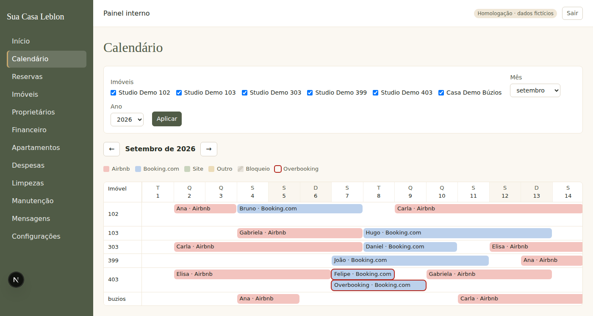 | 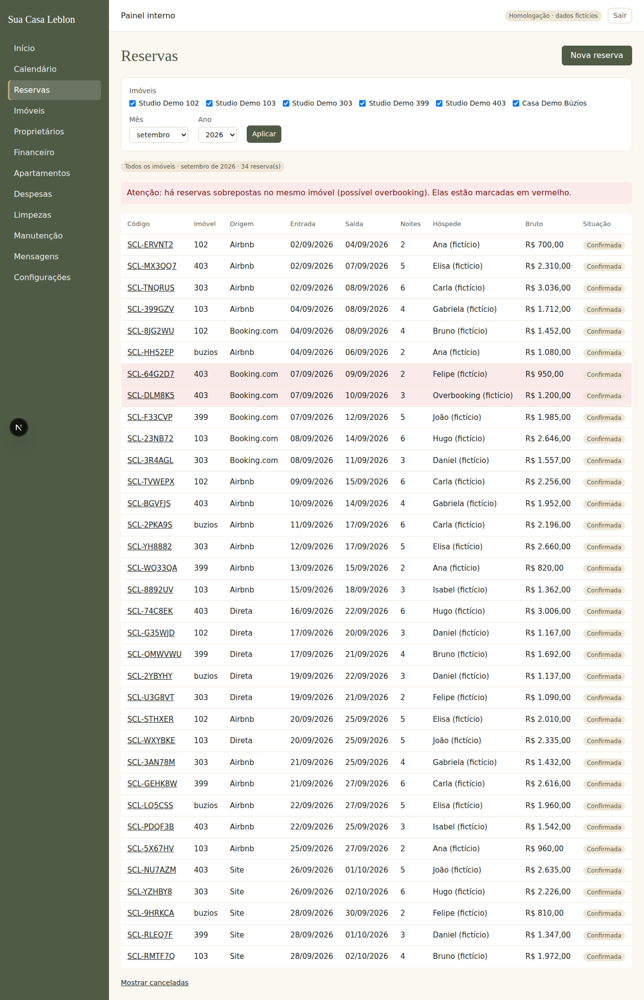 |

| Calendário no celular | Imóveis |
|---|---|
|  | 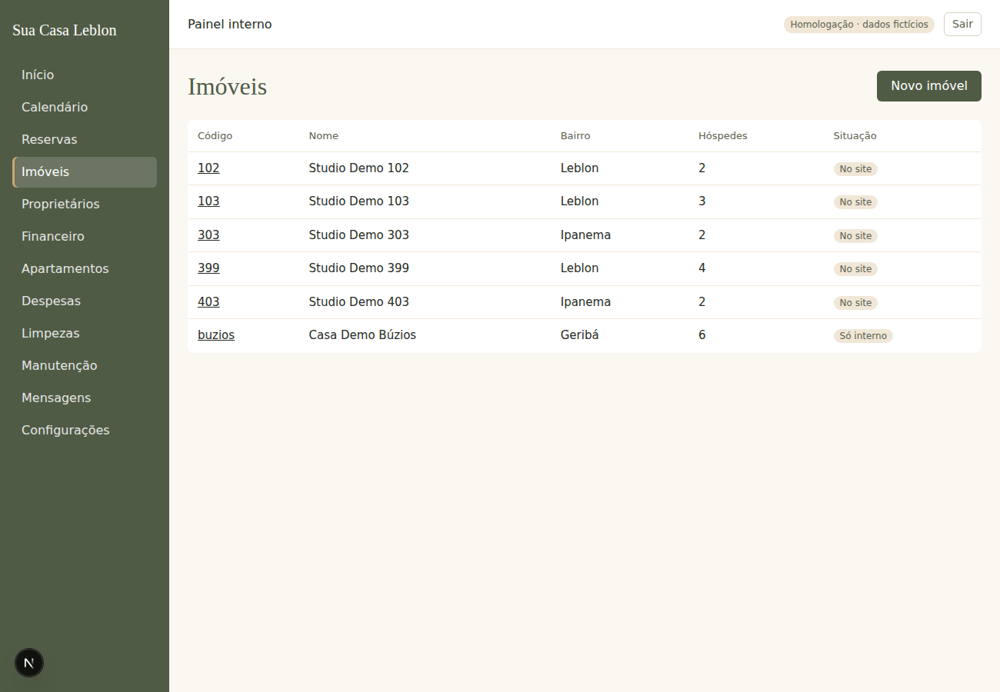 |

| Ficha da reserva com o financeiro | Despesas |
|---|---|
| 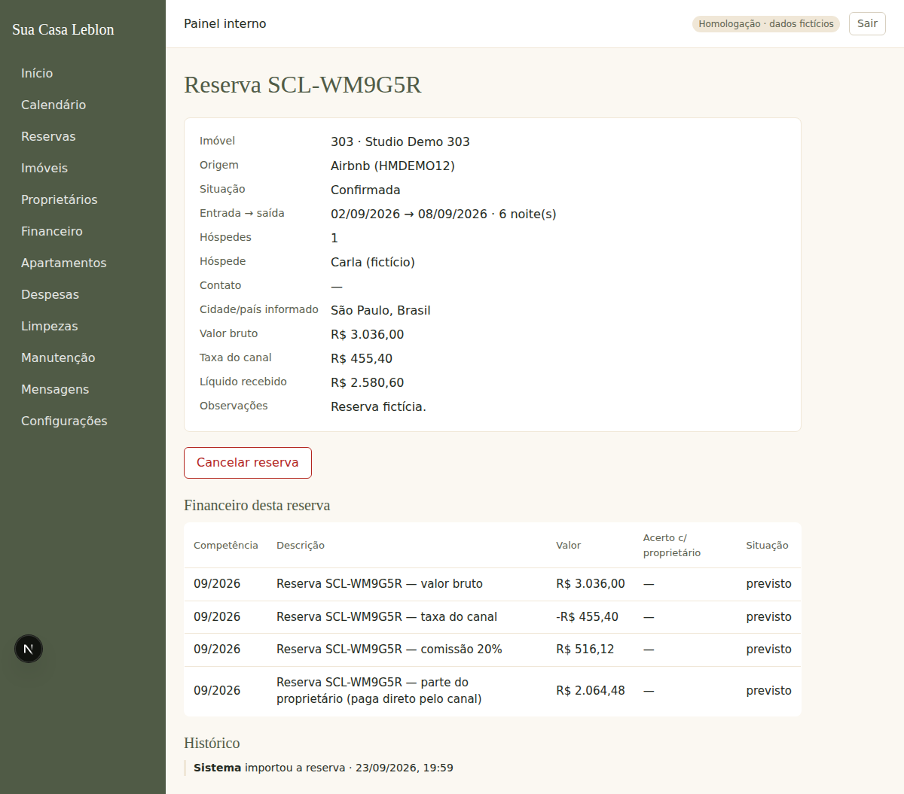 |  |

| Página Sistema | Configurações · Regras financeiras |
|---|---|
|  | 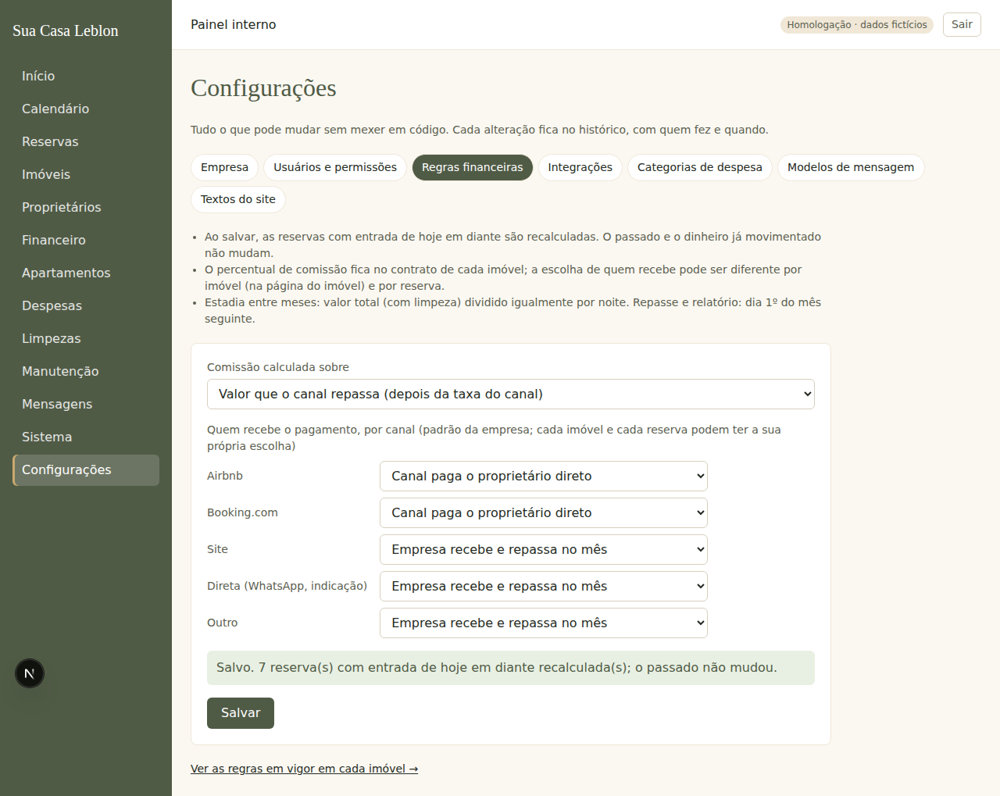 |

| Configurações · Modelos de mensagem | Imóvel · simular estadia |
|---|---|
| 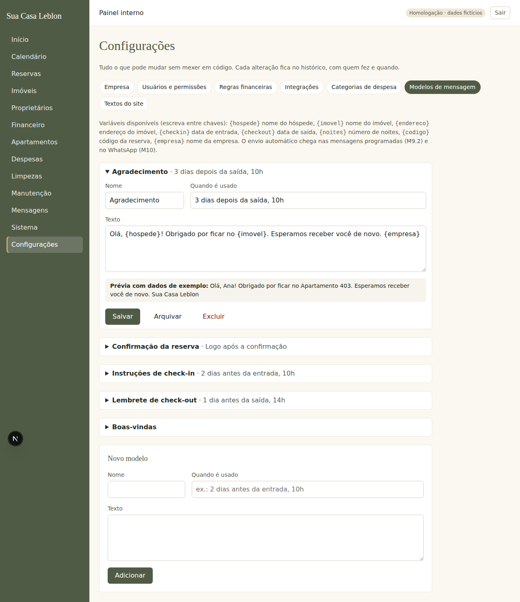 | 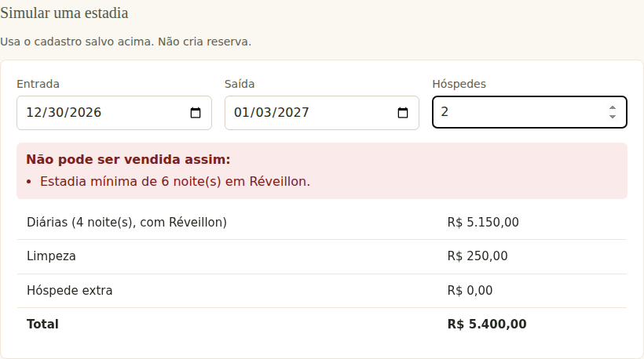 |

| Imóvel · cadastro completo | Adiantamento |
|---|---|
|  |  |

| Ajuste esclarecido | Início no celular |
|---|---|
| 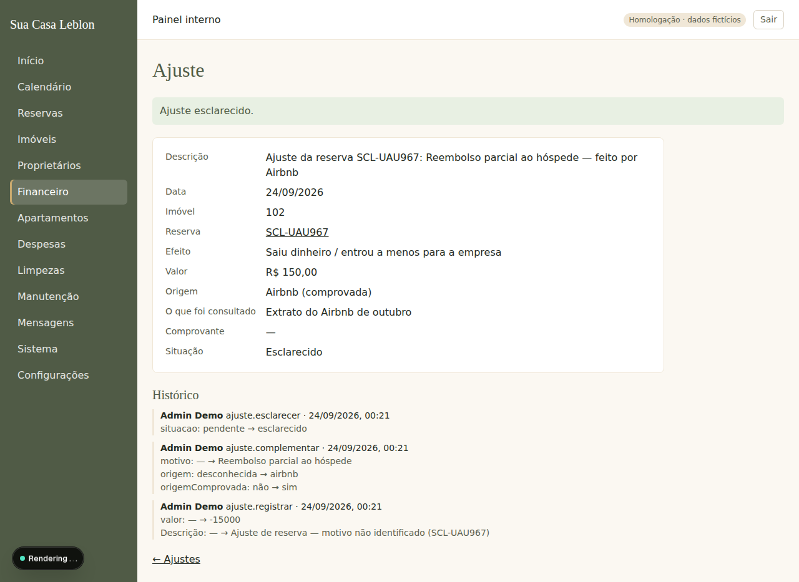 | 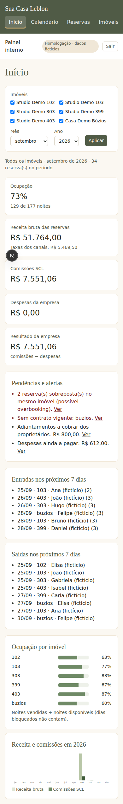 |

| Início (painel com números e alertas) | Repasses no celular |
|---|---|
| 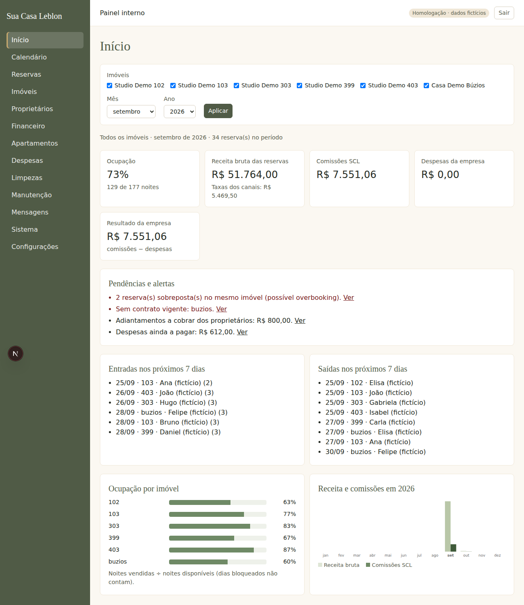 |  |

| Repasses aos proprietários (fechamento do mês) | Portal do proprietário no celular |
|---|---|
| 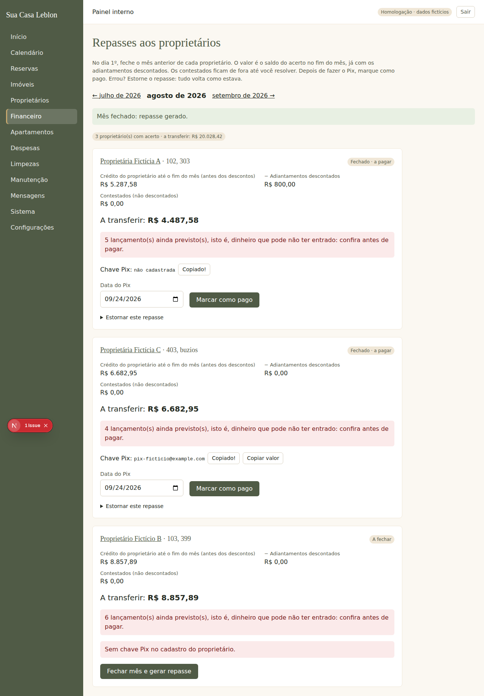 | 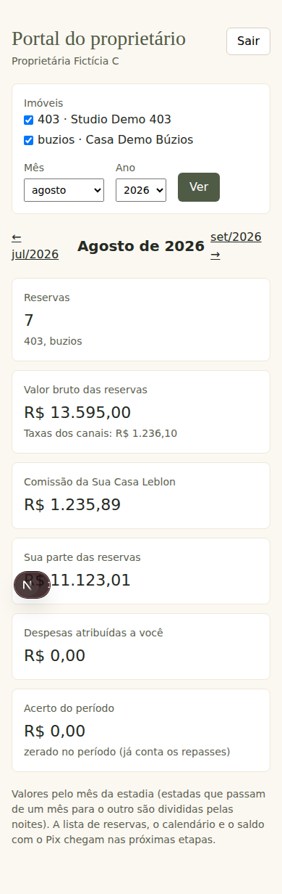 |

| Portal do proprietário |
|---|
| 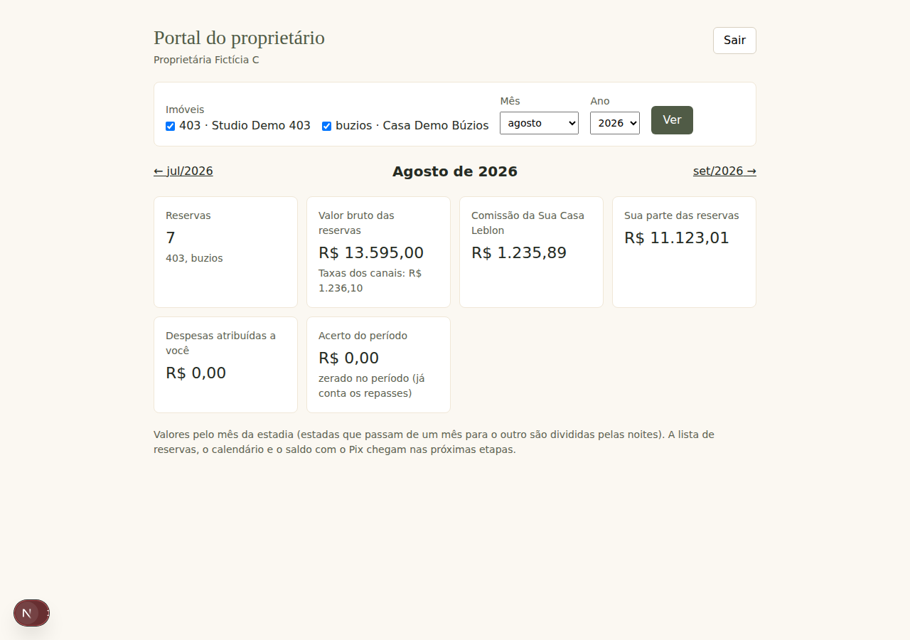 |

A lista completa e detalhada, item por item, está em [ROADMAP.md](ROADMAP.md).

---

## 3. Como o trabalho acontece

1. A **rotina automática** roda a cada 3 horas nesta conversa do Claude Code. Ela pega o
   próximo item do ROADMAP, programa, testa e abre um **PR** no GitHub.
2. Cada PR tem no título o código do item (ex.: `[M1.2] Login com Google`) e uma
   descrição em português com: *O que muda / Como conferir / Testes / Limites*.
3. Dois robôs conferem cada PR automaticamente:
   - **CI** (GitHub Actions): roda todos os testes. Verde = passou.
   - **Codex**: revisão automática de código. O Claude corrige o que ele apontar.
4. **O Claude faz o merge** (autorizado por você em 23/09, até o sistema estabilizar), mas só
   quando o CI está verde, a revisão do Codex terminou sem pendências e não há conflito.
   Você continua podendo ler cada PR — a descrição explica em português o que mudou — e
   pode pedir para voltar a ser você quem faz o merge a qualquer momento.
5. Pode haver até **3 PRs abertos** ao mesmo tempo esperando seu merge.

**Onde ver o sistema:** assim que a Vercel estiver conectada (seção 6), cada PR ganha um
link de *preview*, e a `main` fica publicada num endereço fixo de homologação. O painel
fica em `/painel`.

**Se quiser acompanhar ou pedir algo:** abra esta conversa no app Claude (área *Code*)
e escreva normalmente.

---

## 4. Onde encontrar cada coisa no GitHub

| Pasta ou arquivo | O que tem | Precisa ler? |
|---|---|---|
| `GUIA-DIEGO.md` | Este guia | ✅ sim |
| `ROADMAP.md` | Plano completo, item por item, com o que falta | Se quiser detalhe |
| `requisitos/` | Suas decisões de negócio, escritas e organizadas por tema | Só para conferir regras |
| `docs/telas/` | Prints das telas (dados fictícios), atualizados a cada entrega visual | Se quiser ver |
| `requisitos/operations/FINANCEIRO-PORTAIS.md` | Regras do financeiro e dos portais | Quando chegarmos no M4/M5 |
| `app/` | **O sistema novo** (código) | ❌ não |
| `app/drizzle/` | Histórico das mudanças no banco de dados | ❌ não |
| `prototipos/` | Protótipos antigos (site e gestão), só como referência | ❌ não |
| `arquivo/` | Papelada dos agentes antigos (Rivers, Lia, Sage...), guardada como histórico | ❌ não |
| `CLAUDE.md` | Regras que o Claude segue ao programar | ❌ não |
| `.github/workflows/` | Configuração dos testes automáticos (CI) | ❌ não |

---

## 5. Contas e serviços

| Serviço | Para que serve | Situação | O que falta |
|---|---|---|---|
| **GitHub** (`al-life/scl-reconstrucao`) | Guarda o código e o histórico | ✅ conectado | — |
| **Claude Code** | Programa o sistema; rotina a cada 3h | ✅ ativo | — |
| **Codex** (revisor automático) | Revisa cada PR | ✅ ativo no repositório | — |
| **Neon** | Banco de dados (Postgres) | 🟡 sua conta existe e está paga | Ligar à Vercel (item abaixo) |
| **Vercel** | Publica o sistema na internet (homologação e depois produção) | 🟡 conector começado no Claude, mas incompleto | Terminar a conexão e importar o repositório (seção 6) |
| **Beds24** | Channel manager (Airbnb/Booking), reservas, calendário e preços | 🟡 conta criada; leitor pronto no sistema | Gerar a chave de API **com leitura e escrita** (seção 6) |
| **Mercado Pago** | Pagamentos da reserva direta | ⚪ não conectado | Credenciais de *teste*, mais adiante (M8) |
| **Meta / WhatsApp Business** | Atendimento pelo WhatsApp da empresa | ⚪ não conectado | Verificação da empresa no Meta Business (demora dias) |
| **Google Cloud (login)** | Botão "Entrar com Google" | ⚪ não configurado | Criar credenciais OAuth (seção 6) |
| **Resend** (envio de e-mail) | E-mails do sistema: código de login, convites, relatórios | 🟡 conta criada (e conector no Claude) | Cadastrar o domínio e pôr a chave na Vercel (seção 6, item 5) |
| **Cloudflare** | Domínio e e-mail | ⚪ não conectado | Só no final (M11) |

**Conector do Claude × chave do sistema:** os "conectores" que você liga no Claude (ex.: o
do Resend) deixam **o Claude** usar aquele serviço nas conversas. O **sistema SCL**, rodando
na Vercel, precisa da **sua própria chave** em *Settings → Environment Variables*. São duas
coisas diferentes — as duas são úteis. Hoje, nesta sessão de trabalho, não aparecem os
conectores do Resend nem do Neon, e o da Vercel está com a conexão incompleta; se você
terminar a da Vercel, eu consigo acompanhar os deploys daqui.

**Onde ficam senhas e chaves:** nunca no GitHub e nunca no chat. Elas ficam nas
configurações da Vercel e nas configurações do ambiente do Claude Code (variáveis de
ambiente).

---

## 6. O que você precisa fazer agora

1. **Vercel + Neon** (uns 5 minutos, dá para fazer pelo computador):
   1. Entre em vercel.com → *Add New… → Project* → escolha `al-life/scl-reconstrucao`.
   2. Em **Root Directory**, escolha `app`. Clique em *Deploy*.
   3. No projeto criado: *Storage* (ou *Integrations*) → **Neon** → conecte sua conta
      Neon. Isso cria a variável `DATABASE_URL` automaticamente.
   4. Me avise aqui na conversa: eu confiro se o site de homologação abriu.
2. **Login com Google** (uns 10 minutos, junto com a Vercel):
   1. Em console.cloud.google.com → crie um projeto "SCL" → *APIs e serviços → Tela de
      consentimento OAuth* (tipo "Externo", nome "Sua Casa Leblon").
   2. *Credenciais → Criar credenciais → ID do cliente OAuth → Aplicativo da Web*.
      Em "URIs de redirecionamento autorizados" coloque
      `https://SEU-ENDERECO.vercel.app/api/auth/callback/google` (o endereço que a Vercel der).
   3. Na Vercel, em *Settings → Environment Variables*, crie:
      `AUTH_GOOGLE_ID` e `AUTH_GOOGLE_SECRET` (os dois valores que o Google mostrar),
      `AUTH_SECRET` (qualquer texto longo e aleatório, ex.: gerado em 1password ou similar) e
      `ADMIN_EMAILS` = seu e-mail do Google.
   4. Faça *Redeploy* e entre em `/entrar`. Se travar em algum passo, me chame que eu guio.
3. **Beds24:** gere a chave de API (no painel do Beds24, na área de API, crie um
   "long life token") com permissões de **leitura e escrita** de reservas, calendário
   (inventário/preços) e imóveis — o SCL vai ser a fonte oficial do calendário e dos preços e
   mandar as mudanças para o Beds24 e, dele, para as OTAs. Fica tranquilo: o sistema **só
   escreve** quando o item M3.7 estiver pronto e **você ligar** (primeiro testando num
   imóvel que você escolher). **Não cole no chat.** Coloque nas configurações do
   ambiente do Claude Code (menu do ambiente no topo da sessão → *Edit* → variável
   `BEDS24_API_KEY`) e também na Vercel (*Settings → Environment Variables*).
4. **Meta Business:** comece a verificação da empresa, porque ela demora.
5. **E-mail do sistema (Resend)** — sem pressa; enquanto isso, o login com Google funciona:
   1. Crie conta grátis em resend.com e cadastre o domínio de onde os e-mails vão sair
      (ex.: suacasaleblon.com.br). Ele pede para adicionar alguns registros no DNS
      (Cloudflare) — eu te guio nessa hora.
   2. Crie uma *API key* e coloque na Vercel como `RESEND_API_KEY`, e crie
      `EMAIL_REMETENTE` = `Sua Casa Leblon <acesso@seudominio.com.br>`. **Não cole no chat.**
6. **Chave Pix dos proprietários:** confira no cadastro de cada proprietário (Painel →
   Proprietários) se a chave Pix está preenchida — a tela de Repasses usa ela para o botão
   "Copiar Pix" e avisa quando falta.
7. **Booking:** criar os anúncios (ver "Copiar anúncios do Airbnb para o Booking" na seção 7).
8. **Sistema antigo (referência):** mande o arquivo (zip) do sistema antigo — o jeito mais
   fácil é subir no seu **Google Drive** e me dizer o nome do arquivo (o Drive já está
   conectado aqui). Eu só leio para levantar todas as telas e capacidades e comparar com o
   plano; **nada dele vai para o GitHub**, e dados reais de clientes não são copiados.

---

## 7. Decisões pendentes e respostas às suas perguntas

**Preciso de você (sem pressa):**
- **Modelo do marketplace:** as fórmulas antigas não estão em lugar nenhum, então montei
  uma proposta com as contas feitas: `requisitos/product/MARKETPLACE-PRECIFICACAO.md`.
  Resumo, numa reserva de R$ 1.650 que no Airbnb custaria R$ 1.881 ao hóspede e daria
  R$ 1.600 ao proprietário:
  - **A — taxa de serviço menor (8%):** hóspede paga R$ 1.782, proprietário recebe
    R$ 1.650, SCL fica com ~R$ 52;
  - **B — dividir a economia em três (minha sugestão):** hóspede paga R$ 1.815,
    proprietário recebe R$ 1.667, SCL fica com ~R$ 66;
  - **C — mensalidade fixa + preço limpo:** hóspede paga R$ 1.728, proprietário recebe
    R$ 1.650, SCL vive da mensalidade.
  Os percentuais das OTAs e do pagamento são aproximados e precisam ser conferidos. A ideia
  é ter uma **tela de simulação** com tudo editável para você testar com números reais antes
  de decidir. Me diga qual modelo te agrada mais (ou o que mudar).
- **Búzios:** fica no sistema interno para controle (combinado). No site público, a decidir.
- **Avaliações**: só no Airbnb ou também próprias.

**Respostas:**
- **Telas do sistema antigo:** o **dashboard** inicial com vários indicadores (M4.6) e a aba
  **Apartamentos** com tabela de todos e filtros para escolher como ver (M4.7) já estavam
  no plano — deixei as descrições mais completas. A aba **Anúncios** (M2.9) e as
  **Configurações com sub-abas** (M1.7) entraram agora. Quando você mandar o zip do sistema
  antigo, eu cruzo tudo com o plano (M0.6) e acrescento o que faltar.
- **Avisar em vez de supor:** virou regra do projeto — faltou um dado ou algo não bate, o
  sistema avisa e deixa pendente; nunca preenche com um palpite.
- **Beds24 só leitura?** Não — como o SCL vai ser a fonte oficial de calendário e preços, a
  chave precisa de **leitura e escrita** (seção 6, item 3). Entrou no plano o **M3.7** (SCL
  manda calendário, preços e regras para o Beds24 → OTAs) e o **M5.5** (proprietário mexe
  no calendário do imóvel dele pelo portal; a mudança passa pelo SCL e segue para as OTAs).
  A escrita fica **desligada** até você mandar ligar, depois de testarmos num imóvel.
- **Repasse e relatório mensal:** combinado, **dia 1º do mês seguinte** (no último dia ainda
  pode entrar reserva). Já está no plano (M4.9 e M5.4).
- **E-mail no cadastro de todos:** o e-mail do proprietário passou a ser **obrigatório**
  (convite do portal, relatórios, avisos, às vezes a chave Pix). Hóspedes entram no portal
  pelo e-mail (M9.1). Nas reservas das OTAs o e-mail às vezes vem mascarado pelo canal; o
  sistema guarda o que vier.
- **Tudo editável por você, sem código nem banco:** virou regra do projeto (está no
  `CLAUDE.md`, que toda sessão do Claude segue): cadastros, contratos, taxas, regras de venda,
  textos do site, modelos de mensagem, categorias — tudo com tela de edição. E **uma regra
  fica num lugar só**: quando você muda (um contrato, quem recebe num canal), o sistema
  recalcula o que depende dela na hora; a cada nova versão publicada, recalcula tudo. Não
  ficam duas versões da mesma regra. E a mudança vale **daquela data para frente**: o
  passado e o dinheiro que já movimentou nunca são recalculados. Desde o M1.7, as regras
  gerais, os usuários, os modelos de mensagem e os textos do site estão em **Configurações**.
- **Excluir com confirmação:** todo botão de excluir, remover, cancelar ou estornar agora
  pergunta "tem certeza?" antes. Onde há histórico (financeiro, reservas), o sistema
  prefere arquivar ou estornar em vez de apagar de vez.
- **Área para ver serviços, automações e regras:** entrou no plano como **M1.6** — uma
  página "Sistema" no painel mostrando os serviços ligados (banco, Beds24, e-mail,
  WhatsApp, Mercado Pago) e se estão funcionando, as automações com a última vez que
  rodaram, e as regras em vigor, com atalho para editar.
- **Recebimento do site com divisão automática (como o Airbnb):** existe. O **Mercado Pago**
  tem o modelo "marketplace": cada proprietário liga a conta Mercado Pago dele ao nosso
  sistema, e cada pagamento cai direto na conta dele com a comissão da SCL separada
  automaticamente para a conta da empresa. O **Stripe** faz o mesmo (Stripe Connect). Pontos
  de atenção: cada proprietário precisa ter conta própria; estorno e contestação de cartão
  saem da conta dele; e a parte fiscal muda (ele recebe direto, como no Airbnb). Coloquei no
  plano como **M8.0**: comparar as duas opções (e o "empresa recebe e repassa") antes de
  ligar o pagamento, conferindo taxas e regras atuais na documentação de cada um.
- **Copiar anúncios do Airbnb para o Booking:** é **semiautomático** pelo Beds24 — ele
  reaproveita os dados e fotos que já importou do Airbnb e cria o anúncio no Booking. Mas
  exige a conta Booking da empresa (com os dados da pessoa jurídica) conectada ao Beds24, e
  depois é preciso conferir fotos, políticas, comodidades, camas e preços, porque o Booking
  valida tudo e às vezes pede complemento na extranet. Minha sugestão: fazer **um apartamento
  do Rio primeiro**, até ficar 100% aberto para reservas, e só depois repetir nos outros. Se
  algum anúncio já existir no Booking, a gente **liga** em vez de criar outro. Quando você for
  fazer, me chame que eu te guio tela a tela.
- **Modelos de cliente:** o sistema já tem os dois tipos de contrato — **gestão completa**
  (os cinco do Rio) e **marketplace** (tipo separado, esperando a fórmula). Agora o marketplace
  ganhou um bloco próprio no plano (**M12**): fórmula, cálculo e repasse, auto-cadastro do
  proprietário e portal dele com calendário e preços.
- **Site público:** é a parte que estava mais adiantada, mas ainda como **protótipo
  separado** (`prototipos/scl-publico`): home, catálogo dos 5 imóveis, página de cada um,
  galeria, calendário, formulário de consulta e uma demonstração de checkout sem cobrança.
  Não está no ar, não usa banco e está sem as fotos (faltava autorização de uso). No plano,
  o **M7.1** traz esse site para dentro do sistema novo lendo os imóveis do banco; o **M7.2**
  liga disponibilidade e preço reais (depois do Beds24); o **M7.3** coloca as fotos quando
  você autorizar.
- **Cadastro de apartamento novo:** hoje o cadastro tem código, nome, bairro, endereço,
  capacidade, quartos, banheiros, descrição, se aparece no site, proprietário(s) com todos os
  dados, contratos e os números nos canais. Criei o **M2.6** para o cadastro **completo**:
  endereço completo, camas e comodidades, regras da casa, horários, taxas (limpeza, hóspede
  extra), estadia mínima/máxima **com exceções por período**, antecedência, dias de
  chegada/saída, preço base e **preço dinâmico liga/desliga** — tudo editável pelo painel,
  como nas OTAs. O portal do proprietário puxa daí.
- **Equipe de limpeza:** já estava a agenda diária para a equipe (M6.3); acrescentei o
  **M6.6** — acesso próprio pelo celular (ver a agenda e marcar faxina feita) **e** aviso por
  WhatsApp quando o WhatsApp estiver ligado (por e-mail enquanto isso). As duas formas
  funcionando, como você sugeriu.

---

## 8. Glossário rápido

- **Repositório:** a "pasta" do projeto no GitHub, com todo o histórico.
- **Branch:** uma cópia paralela onde uma mudança é preparada sem mexer no principal.
- **PR (pull request):** o pedido para juntar uma branch ao principal. É onde você revisa.
- **Merge:** aceitar o PR. A mudança passa a fazer parte da versão principal (`main`).
- **CI:** os testes automáticos que rodam em cada PR. Verde = tudo certo.
- **Deploy / publicar:** colocar o sistema no ar (na Vercel).
- **Homologação:** versão de teste no ar, com dados fictícios, antes da versão real.
- **Migração de banco:** um arquivo que cria ou altera tabelas do banco de dados de
  forma controlada.
